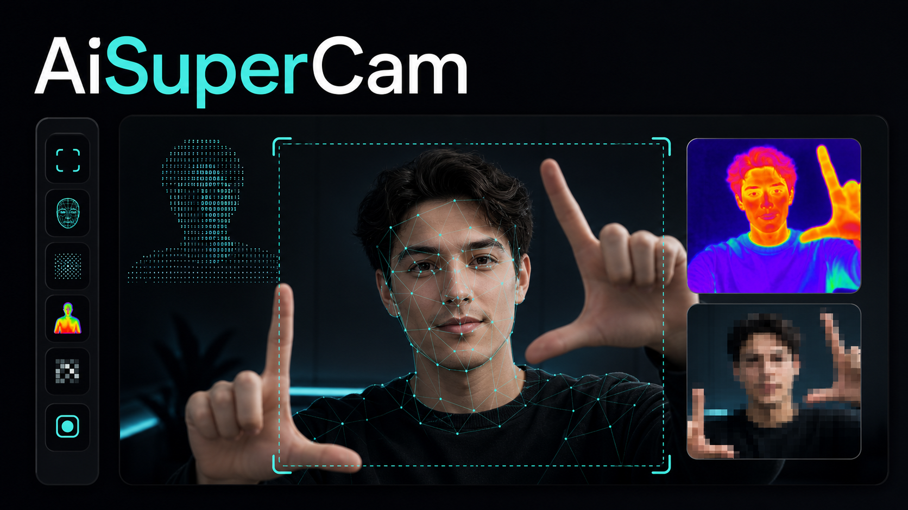

# AiSuperCam

A local, hand-controlled webcam playground. Create up to four areas and apply Mesh, ASCII, Thermal, Pixel and Aura effects at the same time.



_The original visual concept generated before the production UI was designed._

[Open the live demo](https://aisupercam-production.up.railway.app/)

## Run locally

Requires Node.js `>=22.13.0`, a modern browser with WebAssembly support, and a webcam. Camera access works on `localhost` or over HTTPS.

```bash
npm ci
npm run dev
```

Open `http://localhost:3000`, then enable the camera. To validate the project:

```bash
npm test
npm run lint
npm run typecheck
```

## Controls

- Hold an **L with each hand** for half a second to create an area.
- **Pinch inside an area** to move it.
- **Pinch a corner** to resize it; two pinches on opposite corners scale it.
- Mouse and touch always work: drag to create, drag inside to move, and drag a corner to resize.
- Keyboard: `1–5` select effects, `C` creates an area, `R` clears all, `Delete` removes the selection, arrows move it, and `+/-` resize it.

Images and recordings download without area borders, handles, or gesture cursors. Webcam processing, hand tracking and rendering stay in the browser; no frame is uploaded to a server. The app blocks MediaPipe's usage-metrics POST so those pings never leave the page.

## Troubleshooting

- If camera access is blocked, allow it in the browser site settings and reload the page.
- If hand tracking cannot start, the editor remains usable with mouse or touch controls.
- On a deployed copy, use HTTPS so the browser can grant camera access.

## Stack

- React 19 + vinext
- MediaPipe Tasks Vision, with models and WASM runtime served from `public/`
- Canvas 2D compositing, person segmentation and effects
- Railway hosting with Railpack

## Deploy to Railway

The repository includes `railway.json`, so Railway builds with `npm run build`, starts with `npm run start`, and checks `/` before marking the deployment healthy. The server reads Railway's `PORT` environment variable automatically.

## License

[MIT](LICENSE) © 2026 Gabriele Monni. Third-party components retain their original licenses; see [Third-party notices](THIRD_PARTY_NOTICES.md).
